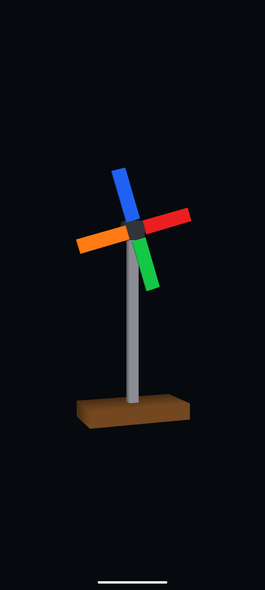
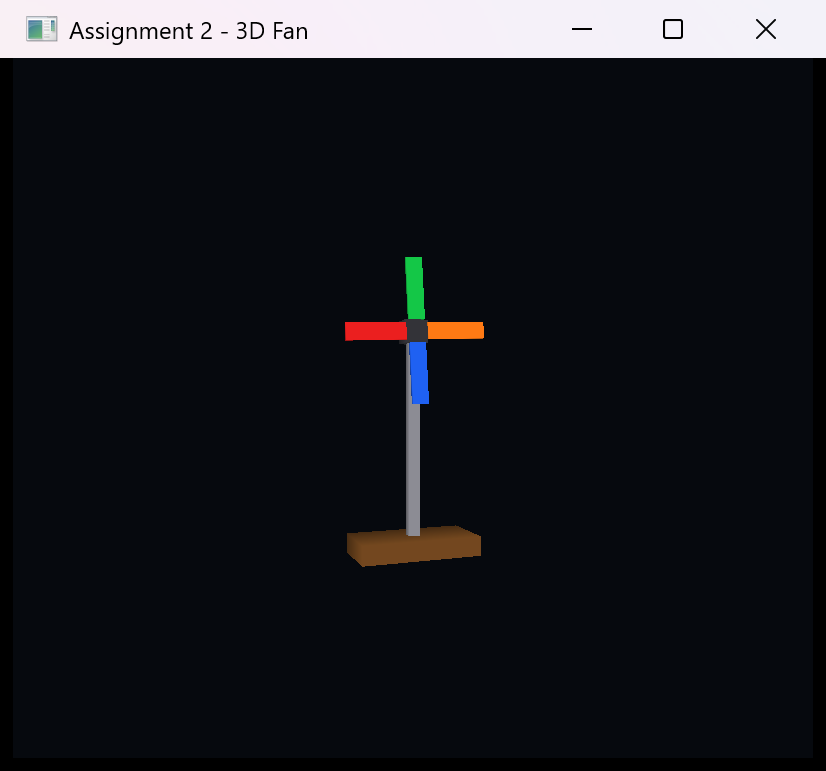
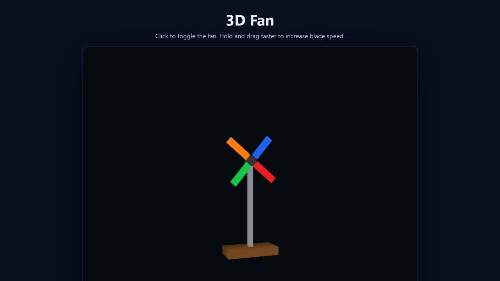

# Assignment 2 - Interactive 3D Fan

A cross-platform OpenGL ES 3.0 fan built from one indexed cube and one shared hierarchical C++ scene. The same `Scene/` implementation runs on Android, Windows, Linux, and WebGL 2.

[Launch the WebGL demo](https://y0y0zo7.github.io/hello-world/Assignment-2-3DFan/)

## Result

| Android | Desktop | WebGL 2 |
| --- | --- | --- |
|  |  |  |

## Controls

- Tap or click with less than 12 pixels of movement to toggle the fan and log `Fan ON` or `Fan OFF`.
- Hold and drag to calculate pointer velocity with `std::chrono::steady_clock`.
- Drag velocity is multiplied by `8` and clamped to a maximum boost of `20` degrees per frame.
- Releasing the pointer resets the boost to zero; the fan returns to its base `1.5` degrees per frame.
- Long-press for at least 600 ms to cycle through 3, 4, and 5 blades at runtime.
- Press `Esc` to exit the Desktop build.

## Rubric implementation

- One eight-vertex cube is reused for the base, pole, hub, and four blades: seven indexed draw calls per frame.
- One VAO owns one VBO and one IBO. Positions and per-corner shades are uploaded through exactly two `glBufferSubData` calls.
- The supplied `Transform.h` and `Transform.cpp` are unchanged. Their SHA-256 hashes are checked automatically.
- The exact world transform is `T(0, 0.8, -8) · RY(20°)`, followed by balanced push/pop branches for each part.
- `PARTCOLOR` is uploaded with `glUniform3fv` for the brown base, light-gray pole, dark-gray hub, and red/blue/orange/green blades.
- Depth testing and front/back corner shades make the shared cube visibly three-dimensional.
- Android touch and Desktop/Web mouse input call the same model callbacks.
- Optional stretch goal: the runtime blade count cycles through 3/4/5, with blades spaced by `360° / count`; the default remains the core four-blade scene.

Run the static rubric guard locally from this directory:

```sh
python scripts/verify_submission.py
```

## Desktop build

Requirements: CMake 3.20 or newer, a C++17 compiler, Git, and an internet connection for the first configure. Linux also needs OpenGL and X11/Wayland development headers.

Windows with Visual Studio 2022:

```bat
script_build_and_run.bat
```

Portable CMake commands:

```sh
cmake -S . -B build -DCMAKE_BUILD_TYPE=Release
cmake --build build --config Release --parallel
ctest --test-dir build -C Release --output-on-failure
```

The first configure downloads only the pinned source dependencies declared in `cmake/ImportDependencies.cmake`: GLM 1.0.3, GLFW 3.4, and GLEW 2.2.0.

## Android build

Requirements: Android SDK 36, NDK `27.0.12077973`, CMake `3.22.1`, Java 17, and the Gradle version pinned by `android/gradle/wrapper/gradle-wrapper.properties`.

```sh
cd android
gradle assembleDebug lintDebug --no-daemon
```

The APK is generated at `android/app/build/outputs/apk/debug/app-debug.apk`. It is a build artifact and is deliberately not committed.

## WebGL build

Activate Emscripten 3.1.64, then run:

```sh
./build_web.sh
python3 -m http.server 8080 --directory web
```

On Windows, use `build_web.bat`. Open `http://localhost:8080`; browsers cannot reliably load WebAssembly from a `file://` URL. The `web/` directory is generated and excluded from Git—GitHub Actions rebuilds it for Pages.

## Fresh submission check on Windows

Start from a newly extracted copy of `Assignment-2-3DFan` so no old CMake or Android path is cached.

### 1. Desktop

Install Visual Studio 2022 with the **Desktop development with C++** workload, CMake, and Git. From the project root, run:

```bat
script_build_and_run.bat
```

The script performs a fresh Release build, runs `FanInteractionTests`, and launches `build\Release\Fan3D.exe`. Confirm that the coloured fan spins, click toggles it on/off, dragging boosts its speed, and a long press cycles through 3/4/5 blades.

### 2. Android

In Android Studio, open the `android` directory, not the parent project directory. In **SDK Manager > SDK Tools**, install NDK (Side by side) `27.0.12077973` and CMake `3.22.1`; install Android SDK 36 under **SDK Platforms**. Use Android Studio's bundled Java 17 runtime, then:

1. Allow Gradle sync to finish.
2. Select **Build > Clean Project**.
3. Select **Build > Rebuild Project**.
4. Run the `app` configuration on an emulator or physical device.

The command-line equivalent, when Gradle is available on `PATH`, is:

```bat
cd android
gradle clean assembleDebug lintDebug --no-daemon
```

The APK appears at `android\app\build\outputs\apk\debug\app-debug.apk`. Confirm the same tap, drag, and long-press controls on the device, and check Logcat for `Fan ON`, `Fan OFF`, swipe velocity, and blade-count messages.

### 3. WebGL

Install and activate Emscripten `3.1.64`, then run from the project root:

```bat
emsdk install 3.1.64
emsdk activate 3.1.64
emsdk_env.bat
build_web.bat
python -m http.server 8080 --directory web
```

Open `http://localhost:8080`. Confirm the coloured fan renders, the browser console has no errors, and click, drag, long-press, fullscreen, and resizing work. Stop the server with `Ctrl+C`.

Before submission, run `python scripts/verify_submission.py`. Do not add the generated `build/`, `build_web/`, `web/`, `external/`, `android/.gradle/`, `android/.idea/`, `android/build/`, `android/app/build/`, or `android/app/.cxx/` directories to the repository or ZIP.

## Continuous integration and deployment

- `.github/workflows/android.yml` builds the APK and runs strict Android Lint.
- `.github/workflows/desktop.yml` builds on Ubuntu and Windows and runs `FanInteractionTests` through CTest.
- `.github/workflows/pages.yml` verifies the rubric, builds the WebAssembly bundle, checks every required asset, and deploys it through GitHub Pages.

Only source, configuration, documentation, and the three required screenshots belong in the repository. Local references, the assignment PDF, sample executable, Gradle/CMake output, APKs, and generated Web files are ignored.
