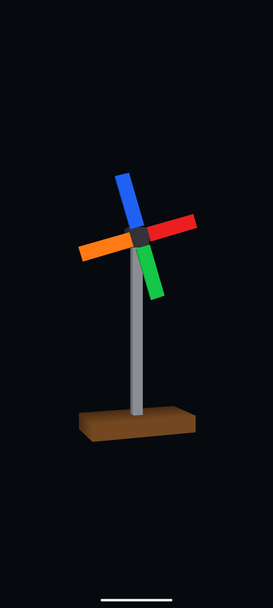
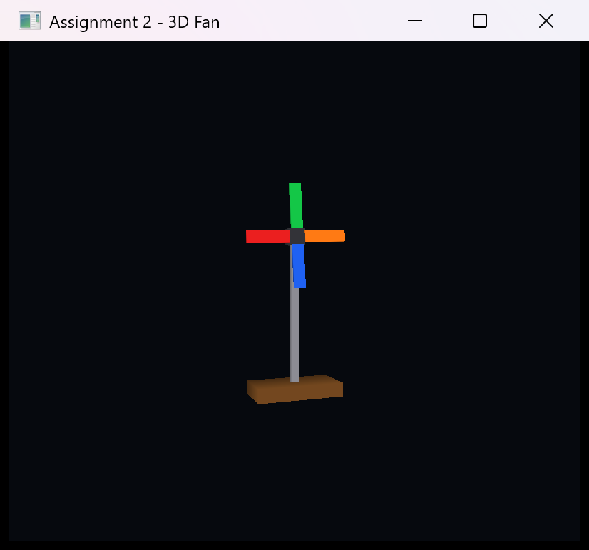
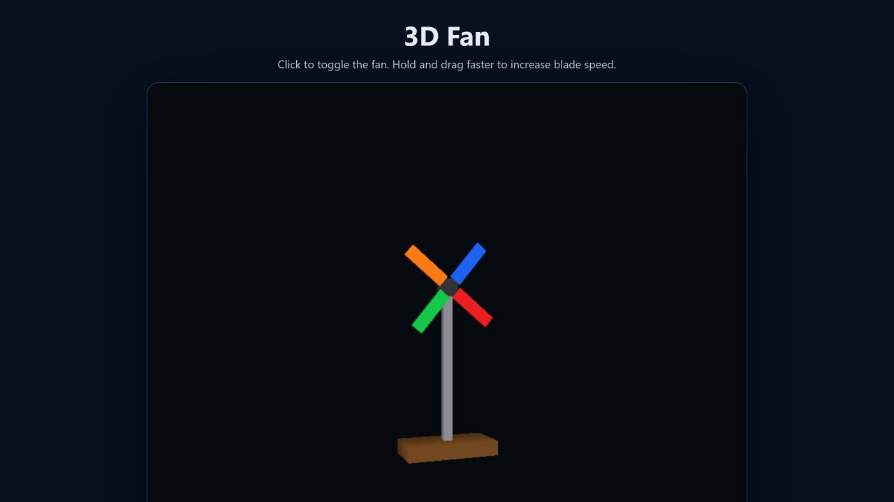

# Assignment 2 - Interactive 3D Fan

A cross-platform OpenGL ES 3.0 fan built from one indexed cube and one shared hierarchical C++ scene. The same `Scene/` implementation runs on Android, Windows, Linux, and WebGL 2.

[Launch the WebGL demo](https://y0y0zo7.github.io/hello-world/android-programming-2/)

## Result

| Android | Desktop | WebGL 2 |
| --- | --- | --- |
|  |  |  |

## Controls

- Tap or click with less than 12 pixels of movement to toggle the fan and log `Fan ON` or `Fan OFF`.
- Hold and drag to calculate pointer velocity with `std::chrono::steady_clock`.
- Drag velocity is multiplied by `8` and clamped to a maximum boost of `20` degrees per frame.
- Releasing the pointer resets the boost to zero; the fan returns to its base `1.5` degrees per frame.
- Press `Esc` to exit the Desktop build.

## Rubric implementation

- One eight-vertex cube is reused for the base, pole, hub, and four blades: seven indexed draw calls per frame.
- One VAO owns one VBO and one IBO. Positions and per-corner shades are uploaded through exactly two `glBufferSubData` calls.
- The supplied `Transform.h` and `Transform.cpp` are unchanged. Their SHA-256 hashes are checked automatically.
- The exact world transform is `T(0, 0.8, -8) · RY(20°)`, followed by balanced push/pop branches for each part.
- `PARTCOLOR` is uploaded with `glUniform3fv` for the brown base, light-gray pole, dark-gray hub, and red/blue/orange/green blades.
- Depth testing and front/back corner shades make the shared cube visibly three-dimensional.
- Android touch and Desktop/Web mouse input call the same model callbacks.

Run the static rubric guard locally from this directory:

```sh
python scripts/verify_submission.py
```

## Desktop build

Requirements: CMake 3.20 or newer, a C++17 compiler, Git, and an internet connection for the first configure. Linux also needs OpenGL and X11/Wayland development headers.

Windows with Visual Studio 2022:

```bat
script_build_and_run.bat
```

Portable CMake commands:

```sh
cmake -S . -B build -DCMAKE_BUILD_TYPE=Release
cmake --build build --config Release --parallel
ctest --test-dir build -C Release --output-on-failure
```

The first configure downloads only the pinned source dependencies declared in `cmake/ImportDependencies.cmake`: GLM 1.0.3, GLFW 3.4, and GLEW 2.2.0.

## Android build

Requirements: Android SDK 36, NDK `27.0.12077973`, CMake `3.22.1`, Java 17, and the Gradle version pinned by `android/gradle/wrapper/gradle-wrapper.properties`.

```sh
cd android
gradle assembleDebug lintDebug --no-daemon
```

The APK is generated at `android/app/build/outputs/apk/debug/app-debug.apk`. It is a build artifact and is deliberately not committed.

## WebGL build

Activate Emscripten 3.1.64, then run:

```sh
./build_web.sh
python3 -m http.server 8080 --directory web
```

On Windows, use `build_web.bat`. Open `http://localhost:8080`; browsers cannot reliably load WebAssembly from a `file://` URL. The `web/` directory is generated and excluded from Git—GitHub Actions rebuilds it for Pages.

## Continuous integration and deployment

- `.github/workflows/android.yml` builds the APK and runs strict Android Lint.
- `.github/workflows/desktop.yml` builds on Ubuntu and Windows and runs `FanInteractionTests` through CTest.
- `.github/workflows/pages.yml` verifies the rubric, builds the WebAssembly bundle, checks every required asset, and deploys it through GitHub Pages.

Only source, configuration, documentation, and the three required screenshots belong in the repository. Local references, the assignment PDF, sample executable, Gradle/CMake output, APKs, and generated Web files are ignored.
