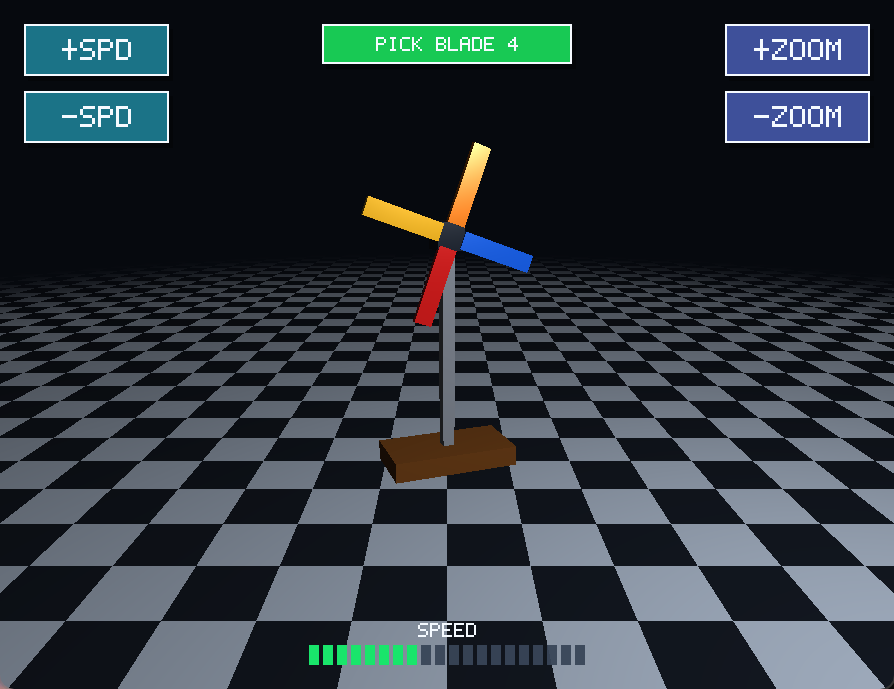
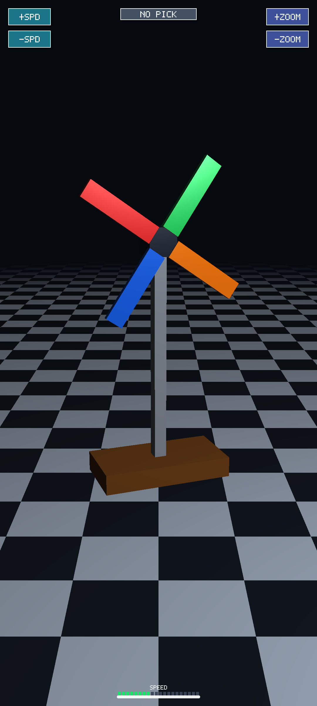
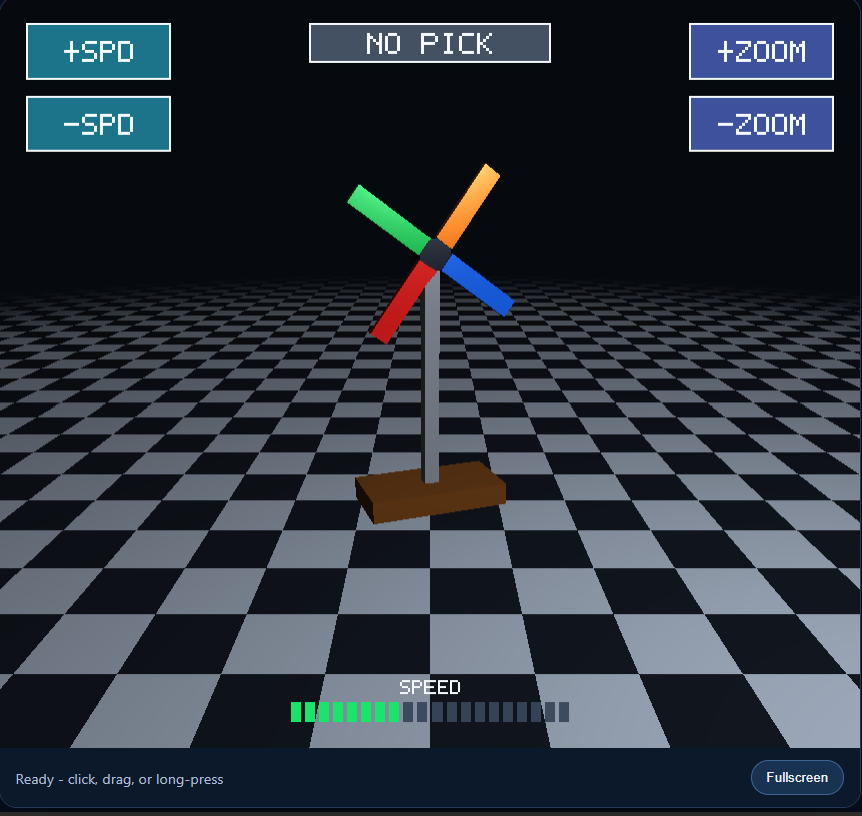

# Programming Quiz 3 — Phong Fan Dashboard

A cross-platform OpenGL ES 3.0 scene that extends Programming Quiz 2 with
Phong lighting, a procedural checkerboard floor, scene-graph ray picking, and
a fixed screen-space HUD. The same `Scene/` implementation runs on Android,
Windows, Linux, and WebGL 2.

[Launch the WebGL demo](https://y0y0zo7.github.io/hello-world/android-programming-quiz3/)

## Submission screenshots

| Desktop — highlighted blade | Android | WebGL 2 |
| --- | --- | --- |
|  |  |  |

The Desktop capture demonstrates the required picking highlight. The Android
capture was taken from a running emulator, and the Web capture is from the
Emscripten/WebGL 2 build.

## Controls

- `+SPD` and `-SPD` change fan speed by one step, clamped to `0–20`.
- `+ZOOM` moves the camera closer and `-ZOOM` moves it farther away, clamped
  to a safe `4–18` distance range owned exclusively by `Scene3D`.
- Pressing a HUD button consumes the input, so it can never select a 3D part.
- Clicking or tapping the fan casts a world-space ray and highlights the
  nearest base, pole, hub, or blade. Selecting the same part again, or clicking
  empty space, clears the selection.
- Press `Esc` to exit the Desktop build.

## Rubric implementation

- `Renderer` owns separate `Scene3D` and `SceneHUD` models.
- Every frame clears once, renders `Scene3D` with depth testing, disables depth
  testing for `SceneHUD`, restores depth testing, and then presents.
- `Scene3D` owns the fan, camera, light, and checkerboard `Ground`.
- Both fan and ground use per-fragment ambient, diffuse, and specular Phong
  shading. Every fan part uploads the inverse-transpose normal matrix after its
  complete hierarchical transform, so blade normals rotate with the blades.
- The floor is generated procedurally in the fragment shader from world-space
  X/Z coordinates; it uses no texture asset.
- `SceneHUD` uses a top-left, pixel-space orthographic projection. Its four
  buttons and 20 individual `10 × 20` pixel speed blocks remain fixed through
  camera changes, window resizing, and device rotation.
- Input is checked against HUD AABBs first. Only a miss is unprojected through
  the supplied `TransformUnproject` function and tested against the seven
  transformed fan-part boxes, nearest hit first.
- Desktop/Web pointer coordinates are normalized from logical window pixels to
  framebuffer pixels, keeping HUD hit tests and 3D picking accurate on high-DPI
  displays.
- The Quiz 2 tap/drag speed control has been removed.

## Bonus features

1. Press-and-hold auto-repeat is implemented for all four HUD buttons. After a
   deliberate 350 ms hold, the active action repeats every rendered frame using
   the level-triggered pattern described in the Scene Graph examples. Speed and
   camera clamps still apply.
2. A second pick-feedback detail appears at the top centre of the HUD. It reports
   `NO PICK`, `PICK HUB`, `PICK BLADE 1`, and so on in a colour-coded strip that
   matches the selected part's material. Like the rest of the HUD, its glyphs
   are built from raw quads with no font or texture dependency.

The compiled test suite checks both bonus state paths.

## Verification

Run the source/rubric guard and compiled tests:

```sh
python scripts/verify_submission.py
cmake -S . -B build -G "Visual Studio 17 2022" -A x64 -DBUILD_TESTING=ON -Wno-deprecated
cmake --build build --config Release
ctest --test-dir build -C Release --output-on-failure
```

On Windows with Visual Studio 2022, `script_build_and_run.bat` performs the
configure, Release build, tests, and launch.

## Android

Requirements: Android SDK 36, NDK `27.0.12077973`, CMake `3.22.1`, Java 17,
and the Gradle version pinned in `android/gradle/wrapper/gradle-wrapper.properties`.

```sh
cd android
gradle assembleDebug lintDebug --no-daemon
```

The APK is generated at
`android/app/build/outputs/apk/debug/app-debug.apk`.

## WebGL 2

Activate Emscripten `3.1.64`, then:

```sh
./build_web.sh
python3 -m http.server 8080 --directory web
```

Open `http://localhost:8080`; WebAssembly should be served over HTTP rather
than opened from `file://`.

## Continuous integration

The repository-level workflows build Programming Quizzes 1, 2, and 3 for
Windows, Linux, and Android. Quiz 3 also runs its rubric verifier, compiled
interaction tests, Android Lint, Emscripten build, asset checks, and GitHub
Pages deployment.

Generated builds, local SDK settings, the assignment PDF, sample executable,
APKs, and WebAssembly output are intentionally excluded from version control.
